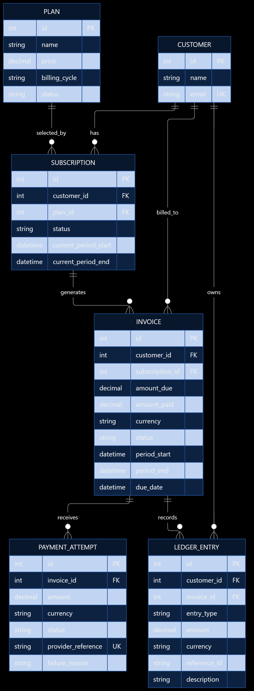

# SubLedger – System Design Document

## 1. Project Overview

SubLedger is a SaaS subscription billing backend built using FastAPI, SQLAlchemy, and PostgreSQL. It manages subscription plans, customers, subscriptions, invoices, payment attempts, and financial ledger entries.

The application provides REST APIs for managing the subscription lifecycle and recording payments while maintaining financial consistency through database transactions and validation rules.

## 2. Technology Stack

| Component | Technology |
|---|---|
| Programming Language | Python |
| Backend Framework | FastAPI |
| ORM | SQLAlchemy 2.x |
| Database | PostgreSQL |
| Data Validation | Pydantic |
| Testing | Pytest |
| Containerization | Docker and Docker Compose |
| API Documentation | OpenAPI / Swagger UI |

## 3. High-Level Architecture

The application follows a layered architecture to separate API handling, business logic, and database operations.

**Request flow:**

API Layer → Service Layer → Repository Layer → Database

- **API Layer:** Exposes REST endpoints, validates incoming requests, and returns HTTP responses.
- **Service Layer:** Implements business rules and coordinates application workflows.
- **Repository Layer:** Encapsulates database operations and data access.
- **Database Layer:** Manages SQLAlchemy sessions, connections, and persistence.

This separation improves maintainability, testability, and the ability to evolve individual layers independently.

## 4. Core Domain Entities

| Entity | Responsibility |
|---|---|
| Plan | Stores subscription plan details, pricing, billing interval, and active status. |
| Customer | Stores customer information, including a unique email address. |
| Subscription | Connects a customer to a plan and tracks subscription status and billing dates. |
| Invoice | Stores the amount due, amount paid, invoice status, and billing period. |
| PaymentAttempt | Records each payment attempt, including amount, status, and provider reference. |
| LedgerEntry | Maintains an append-only record of financial events associated with invoices and payments. |

## 5. Entity Relationship Diagram



[//]: # (erDiagram)

[//]: # (    CUSTOMER ||--o{ SUBSCRIPTION : has)

[//]: # (    PLAN ||--o{ SUBSCRIPTION : selected_by)

[//]: # (    SUBSCRIPTION ||--o{ INVOICE : generates)

[//]: # (    INVOICE ||--o{ PAYMENT_ATTEMPT : receives)

[//]: # (    CUSTOMER ||--o{ LEDGER_ENTRY : owns)

[//]: # (    INVOICE ||--o{ LEDGER_ENTRY : records)

[//]: # ()
[//]: # (    CUSTOMER {)

[//]: # (        int id PK)

[//]: # (        string name)

[//]: # (        string email UK)

[//]: # (    })

[//]: # ()
[//]: # (    PLAN {)

[//]: # (        int id PK)

[//]: # (        string name)

[//]: # (        decimal price)

[//]: # (        string billing_interval)

[//]: # (        boolean is_active)

[//]: # (    })

[//]: # ()
[//]: # (    SUBSCRIPTION {)

[//]: # (        int id PK)

[//]: # (        int customer_id FK)

[//]: # (        int plan_id FK)

[//]: # (        string status)

[//]: # (        datetime current_period_start)

[//]: # (        datetime current_period_end)

[//]: # (    })

[//]: # ()
[//]: # (    INVOICE {)

[//]: # (        int id PK)

[//]: # (        int subscription_id FK)

[//]: # (        decimal amount_due)

[//]: # (        decimal amount_paid)

[//]: # (        string status)

[//]: # (    })

[//]: # ()
[//]: # (    PAYMENT_ATTEMPT {)

[//]: # (        int id PK)

[//]: # (        int invoice_id FK)

[//]: # (        decimal amount)

[//]: # (        string status)

[//]: # (        string provider_reference UK)

[//]: # (    })

[//]: # ()
[//]: # (    LEDGER_ENTRY {)

[//]: # (        int id PK)

[//]: # (        int customer_id FK)

[//]: # (        int invoice_id FK)

[//]: # (        string entry_type)

[//]: # (        decimal amount)

[//]: # (        string reference_id)

[//]: # (    })

[//]: # (```)

## 6. Entity Relationships

- A customer can have multiple subscriptions.
- A plan can be associated with multiple subscriptions.
- A subscription can generate multiple invoices over its lifecycle.
- An invoice can have multiple payment attempts.
- A customer can have multiple ledger entries.
- An invoice can be associated with multiple ledger entries.

Foreign keys maintain referential integrity between related entities.

## 7. Key Design Decisions

- **Invoice amount snapshot:** The invoice stores the plan price at the time of invoice generation. Subsequent plan price changes do not alter previously generated invoices.
- **Active subscription constraint:** A customer cannot have duplicate active subscriptions for the same plan.
- **Payment consistency:** Successful payments update the invoice's paid amount and status within a database transaction.
- **Failed payment handling:** Failed attempts are recorded without changing the invoice's paid amount.
- **Ledger traceability:** Financial events are recorded with references to the associated business entities.

## 8. Data Integrity and Transaction Management

Database constraints enforce important data integrity rules, including unique customer emails, positive plan prices, valid invoice amounts, and unique payment provider references.

Financial operations use database transactions to ensure related changes are committed together. If an operation fails, the transaction is rolled back to prevent partially applied financial updates.

Payment processing uses row-level locking on the invoice to reduce the risk of concurrent successful payments exceeding the outstanding balance.

## 9. API Design

The backend exposes RESTful endpoints grouped around the core domain entities:

- Plans: create, retrieve, and update subscription plans.
- Customers: create and retrieve customer records.
- Subscriptions: create, retrieve, and cancel subscriptions.
- Invoices: generate invoices and retrieve invoice details.
- Payments: record successful or failed payment attempts.
- Ledger: retrieve a customer's financial transaction history.

FastAPI automatically generates OpenAPI documentation, accessible through the Swagger UI at `/docs` when the application is running.


## 10. Service Responsibilities

| Service | Responsibility |
|---|---|
| PlanService | Plan creation, updates and validation |
| CustomerService | Customer creation and email uniqueness |
| SubscriptionService | Subscription lifecycle and plan validation |
| InvoiceService | Invoice generation and billing calculations |
| PaymentService | Payment validation and invoice updates |
| LedgerService | Financial event recording and retrieval |

## 11. Repository Responsibilities

The repository layer is implemented in a consolidated `repositories.py` module. It encapsulates database access and provides reusable operations for the service layer.

| Repository | Responsibility |
|---|---|
| PlanRepository | Plan creation, retrieval, and updates |
| CustomerRepository | Customer creation and retrieval |
| SubscriptionRepository | Subscription creation and retrieval |
| InvoiceRepository | Invoice creation and retrieval |
| PaymentAttemptRepository | Payment attempt persistence and retrieval |
| LedgerRepository | Ledger entry creation and retrieval |

Repositories focus on database operations, while business validation and workflow coordination remain in the service layer.

The current implementation groups repository classes in a single module to keep the project structure compact.

## 12. Business Rule Ownership

| Business Rule | Enforcement Layer |
|---|---|
| Positive plan price | Pydantic schema and database constraint |
| Unique customer email | CustomerService and database unique constraint |
| Active plan required for subscription | SubscriptionService |
| Unique active subscription | SubscriptionService and partial unique index |
| Invoice price snapshot | InvoiceService |
| Payment cannot exceed outstanding balance | PaymentService |
| Failed payment does not update invoice amount | PaymentService |
| Invoice status calculation | PaymentService |
| Append-only ledger operations | LedgerService and application-level restrictions |

Database constraints provide an additional layer of data integrity, while service classes enforce business workflows and validation.

## 13. Invoice Generation Flow

1. API receives the subscription ID.
2. InvoiceService retrieves the subscription.
3. Subscription existence and status are validated.
4. The associated plan is retrieved.
5. The billing period and current plan price are determined.
6. The system checks for an existing invoice for the same billing period.
7. A new invoice is created using the current plan price as an amount snapshot.
8. An invoice_created ledger entry is created for traceability.
9. Invoice and ledger changes are committed within a database transaction.
10. The generated invoice is returned in the API response.

If an error occurs during invoice generation, the transaction is rolled back to prevent partial database updates.

## 14. Payment Recording Flow

1. API receives the invoice ID, amount, currency, and payment status.
2. PaymentService retrieves the invoice using a row-level lock.
3. Invoice existence and payment eligibility are validated.
4. Payment currency is checked against the invoice currency.
5. The payment amount is validated against the outstanding balance for successful payments.
6. A PaymentAttempt record is created.
7. For successful payments, the invoice's amount_paid is updated.
8. Invoice status is recalculated as partially paid or paid.
9. For failed payments, the invoice's amount_paid remains unchanged.
10. A corresponding ledger entry is created.
11. All database changes are committed within the transaction.
12. The payment result is returned.

If an error occurs, the transaction is rolled back to prevent inconsistent financial records.

## 15. Transaction Management

SQLAlchemy sessions manage database transactions.

Payment processing uses row-level locking on the invoice to reduce race conditions when multiple payment requests target the same invoice.

Invoice updates, payment attempt creation, and ledger entry creation are committed atomically. If any operation fails, the transaction is rolled back.

## 16. Design Patterns

### Repository Pattern

Repository classes encapsulate database access and persistence operations, separating data access from business workflows.

### Service Layer Pattern

Service classes coordinate business logic, validations, and workflows such as subscription creation, invoice generation, and payment recording.

### Dependency Injection

FastAPI dependency injection provides database sessions to API endpoints, helping manage database resources and simplify testing.

## 17. Limitations

- No real payment gateway integration.
- No automated recurring billing.
- No subscription proration.
- No authentication or role-based authorization.
- Billing periods use simplified fixed durations.
- Ledger immutability is enforced at the application level rather than through database permissions or triggers.
- Database schema creation currently uses SQLAlchemy metadata rather than a complete Alembic migration workflow.